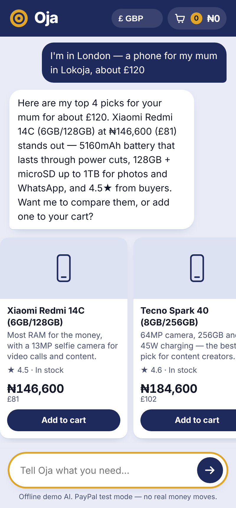
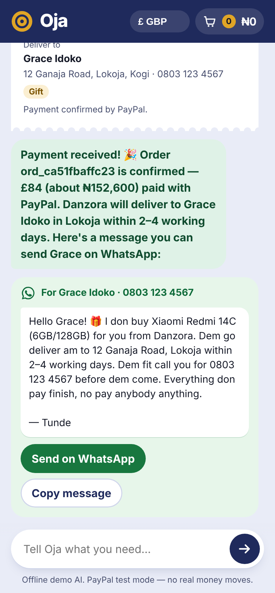
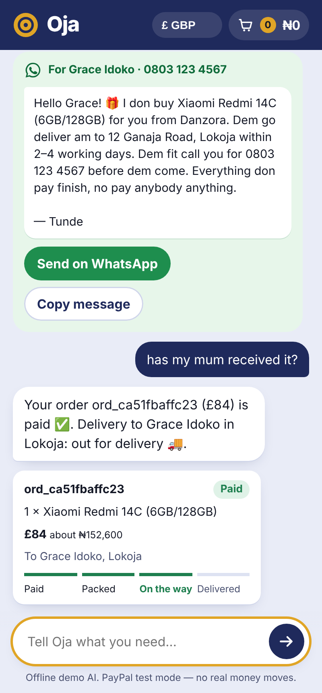

# Oja — buy for family back home, pay with PayPal, all in one chat

**Oja** (Yoruba for *market*) is an AI salesperson for small online stores in Nigeria. A buyer describes what they need in plain words. Oja finds the right products, builds the cart, collects the delivery address, and takes payment with **PayPal**, without the buyer ever leaving the chat.

Its speciality is **Nigerians abroad buying for family back home**. A nurse in London types *"a phone for my mum in Lokoja, about £120"*. Oja picks one, takes mum's name, number and address, and charges in pounds through PayPal. The store then delivers in Nigeria. Finally, Oja writes a WhatsApp message (in English, Pidgin, Yoruba, Igbo or Hausa) for the buyer to send mum: *"Your new phone is on its way, it's fully paid."*

**Live demo:** https://oja-xbd0.onrender.com · **Seller dashboard:** https://oja-xbd0.onrender.com/seller

Built for the **PayPal AI Hackathon 2026** by Idoko Daniel, a computer science student in Lokoja who runs the demo store, **Danzora**.

<p>
  
  
  
</p>


## The problem

Millions of Nigerians abroad send money home, often for a specific thing: a phone for mum, a laptop for a sibling at university. Today that means sending cash and hoping it's spent on the phone they meant to buy. Otherwise they negotiate with a seller back home over WhatsApp, in naira they can't pay in, with no proof the item ever arrived.

At the same time, small Nigerian online sellers lose sales in long chats. Buyers ask "how much?", "is it available?" and "send account details", and drop off at every step.

## What Oja does

**For buyers, at home or abroad**
- Understands needs and budgets in naira or foreign currency: *"a phone under 200k for content"*, *"about £120"*.
- Shows naira prices next to the amount PayPal will charge in the buyer's own currency: **USD, GBP, EUR or CAD**. It picks the currency from the browser (en-GB → £) or from the chat ("I'm in London").
- Compares options, admits when something is out of stock and offers the closest alternative, and builds the cart from conversation: *"add the cheaper one and a power bank"*.
- **Buy for family back home:** collects the recipient's name, Nigerian phone number and address, even typed in one line (*"Grace Idoko, 0803 123 4567, 12 Ganaja Road"*). It also checks the state, and won't check out until the address is complete.
- **Pays inside the chat:** the checkout appears as a receipt with PayPal buttons and the delivery address. The server captures the payment and verifies the amount before stamping it *PAID*.
- **A WhatsApp message for the family**, in the buyer's chosen language, with a one-tap *Send on WhatsApp* button.
- **Tracking:** *"Has my mum received it?"* shows paid → packed → on the way → delivered.
- **Pay later:** *"send me an invoice"* creates a PayPal invoice with a QR code for paying from another phone.

**For sellers** (`/seller`)
- Revenue in naira, broken down by the currencies buyers actually paid in.
- **Orders and deliveries table (AG Grid):** who it's for, which city, gift or not, paid amount in both currencies, and where the buyer came from. Change the delivery step from a dropdown and the buyer's chat is told immediately.
- **What Oja noticed:** AI-written insights, e.g. *"Market to Nigerians abroad — family gifts are 60% of your sales, paid in GBP."*
- Demand that went unmet (asked for while out of stock), top requests, delivery cities, traffic sources (`?src=whatsapp`), and full chat transcripts.

## How PayPal and AI are used

| | What | Where |
|---|---|---|
| AI | **Google Gemini function calling.** The agent chooses among 11 tools: `search_products`, `get_product`, `compare_products`, `add_to_cart`, `remove_from_cart`, `view_cart`, `set_currency`, `set_delivery`, `create_checkout`, `send_invoice`, `check_order_status`. It can take up to 6 tool steps per message. | `src/agent/gemini.js`, `src/agent/tools.js` |
| AI | Gemini writes the family WhatsApp message in Pidgin, Yoruba, Igbo or Hausa, and writes the seller insights. | `src/family.js`, `src/insights.js` |
| PayPal | **Orders v2 in the buyer's currency.** `create_checkout` creates an itemised order in USD, GBP, EUR or CAD. For gifts it ships to the recipient's Nigerian address (`shipping` + `SET_PROVIDED_ADDRESS`). The PayPal JS SDK buttons render in the chat (reloaded per currency). The server **captures** and checks the captured amount and currency before marking the order paid. | `src/paypal.js`, `server.js`, `public/app.js` |
| PayPal | **Invoicing v2.** `send_invoice` creates, sends and fetches an invoice in the buyer's currency, plus PayPal's QR code. The chat polls until it's paid. | `src/paypal.js` |
| Render | Hosted on Render, with a Blueprint (`render.yaml`) for one-click deploy, a `/healthz` health check, and secrets kept out of git. | `render.yaml`, `server.js` |
| AG Grid | The seller's orders and deliveries table, with custom cell renderers and an inline delivery-step control. | `public/seller.js` |

**Safety by design:** the AI never sets prices. Every total is computed on the server from the naira catalog. The agent can only act through tools. Buyers only ever pay through PayPal, and Oja never asks for card or bank details. The family message tells the recipient the order is fully paid and to pay nobody on delivery, which protects them against delivery scams.

## Run it locally (2 minutes)

Requires **Node.js 18+**.

```bash
git clone https://github.com/didoko69/oja
cd oja
npm install
cp .env.example .env   # optional — works without keys
npm start
```

- Buyer chat: http://localhost:3000
- Seller dashboard: http://localhost:3000/seller

**No keys?** Oja runs in **offline demo mode**: a rule-based assistant drives the same tools, and PayPal is simulated (clearly labelled "test mode"). Every flow can be tried end to end.

**Real AI and real PayPal sandbox:**
1. Get a free Gemini API key at https://aistudio.google.com/apikey and set `GEMINI_API_KEY`.
2. At https://developer.paypal.com → *Apps & Credentials* → *Sandbox*, create an app. Set `PAYPAL_CLIENT_ID` and `PAYPAL_CLIENT_SECRET`, and set `PAYPAL_MERCHANT_EMAIL` to your sandbox business account email.
3. Restart. To pay, log in with a **sandbox personal (buyer)** account from *Sandbox → Accounts*.

The bottom of the chat shows which AI and PayPal mode is active.

## Try this conversation

1. Tap **"I'm in London — a phone for my mum in Lokoja, about £120"**
2. *compare them* → *add the first one*
3. *Grace Idoko, 0803 123 4567, 12 Ganaja Road*
4. *in pidgin* → *my name is Tunde*
5. *checkout* → tap the PayPal button → tap **Send on WhatsApp**
6. Open `/seller` and set the delivery step to **Out for delivery**
7. Back in the chat: *has my mum received it?*

Shopping for yourself in Nigeria works too: *"a phone under 200k for content"*, *"send me an invoice"*, *"do you have iphone 15 pro max?"* (out of stock → closest alternative).

## Catalog, prices and rates

The demo catalog is 21 real products sold in Nigeria, priced in naira from Nigerian retailers:

- Phones: Slot, Jumia and Konga prices compiled by [TechCabal (May 2026)](https://techcabal.com/2026/05/28/cheapest-phones-in-nigeria-and-their-prices/)
- Laptops: [NaijaTechGuide price ranges (Jan 2026)](https://www.naijatechguide.com/laptop-prices-in-nigeria-hp-dell-acer.html)
- Earbuds: [NigerianQueries price list](https://nigerianqueries.com/cheapest-quality-earbuds-in-nigeria/)
- A few accessories use typical Lagos market prices (marked `estimatedPrice` in `src/catalog.js`).

Product photos are freely licensed images from [Wikimedia Commons](https://commons.wikimedia.org), credited and linked on each product card. Only exact models (or near-identical ones, labelled as such) get a photo; the rest show a category icon.

PayPal can't charge in naira, so prices convert to the buyer's currency at the official NFEM rate: ₦1,333.54 per $1 (19 Oct 2026). The GBP and EUR rates apply August 2026 NFEM cross rates to that dollar rate, and CAD is an estimate. All rates are settings (`NGN_PER_USD`, `NGN_PER_GBP`, `NGN_PER_EUR`, `NGN_PER_CAD`).

## Going live: receiving payments in Nigeria

The sandbox demo works end to end. In production, PayPal accounts registered in Nigeria have historically been restricted from *receiving* payments. A real launch would therefore settle through a merchant entity or payment partner in a supported country (for example, a UK-registered business account for UK buyers), then pay out to the Nigerian store. Oja's design doesn't change: the buyer still pays with PayPal in their own currency.

## Project structure

```
server.js               Express API and routes
render.yaml             Render Blueprint (one-click deploy)
src/config.js           Settings, exchange rates, delivery
src/money.js            Currencies, conversion, budget/currency detection
src/nigeria.js          States, cities, phone numbers, address parsing
src/catalog.js          Store catalog (naira) and search
src/store.js            Sessions, carts, orders, events (JSON snapshot in data/)
src/paypal.js           PayPal Orders v2 + Invoicing v2 client (sandbox or mock)
src/family.js           WhatsApp message for the family (Gemini or templates)
src/agent/tools.js      The agent's 11 tools
src/agent/gemini.js     Gemini function-calling loop
src/agent/offline.js    Offline demo brain (same tools, no key needed)
src/agent/prompt.js     System prompt
src/insights.js         Seller analytics + AI insights
public/                 Buyer chat and seller dashboard (vanilla HTML/CSS/JS, AG Grid)
test/flow.test.js       24 end-to-end tests (offline mode)
```

Run the tests with `npm test`.

## Deploy on Render

Click **New → Blueprint** on [Render](https://render.com) and point it at this repo. `render.yaml` sets up the free web service with a health check. Then add `GEMINI_API_KEY`, `PAYPAL_CLIENT_ID` and `PAYPAL_CLIENT_SECRET` in the dashboard.

## What's next

- A WhatsApp Business channel, so buyers abroad can shop from the app they already use with family.
- Proof of delivery: the courier uploads a photo, and the buyer gets it in the chat.
- Group gifting: siblings in different countries split one gift for mum, each paying in their own currency.
- Seller catalog upload from a spreadsheet or product photos.

## License

MIT — see [LICENSE](LICENSE).
