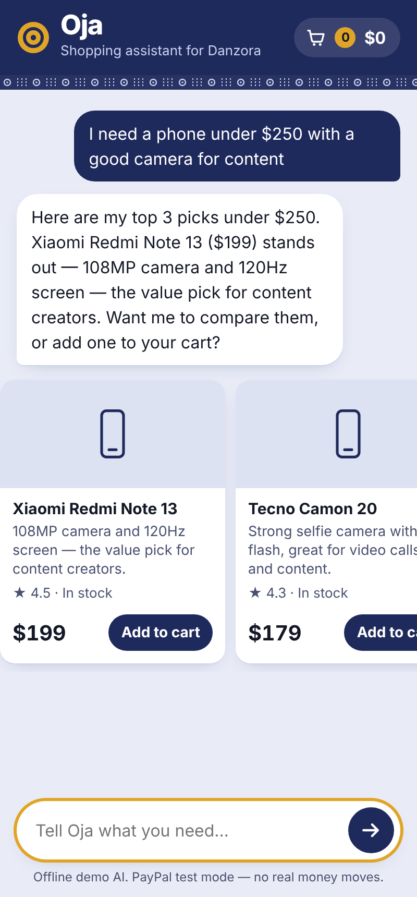
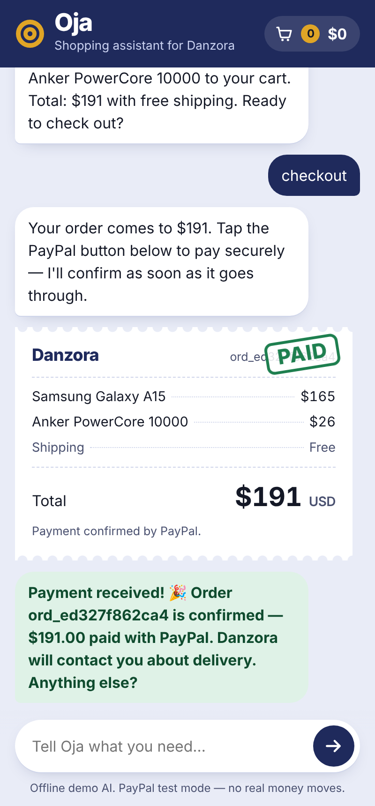
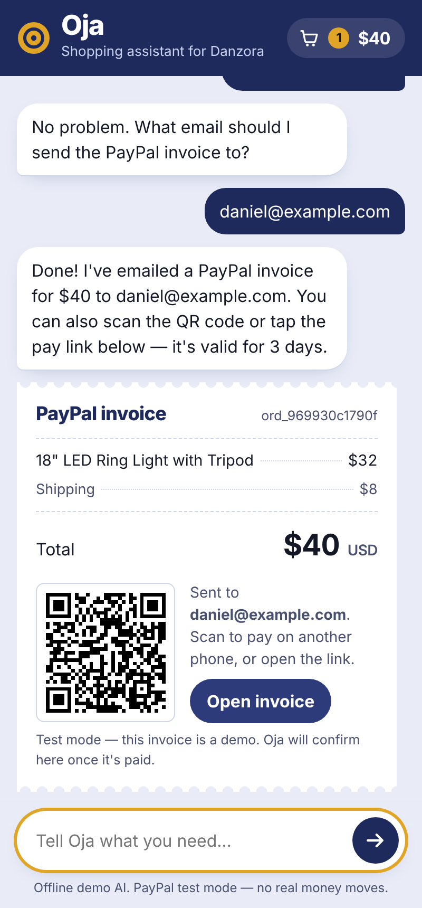
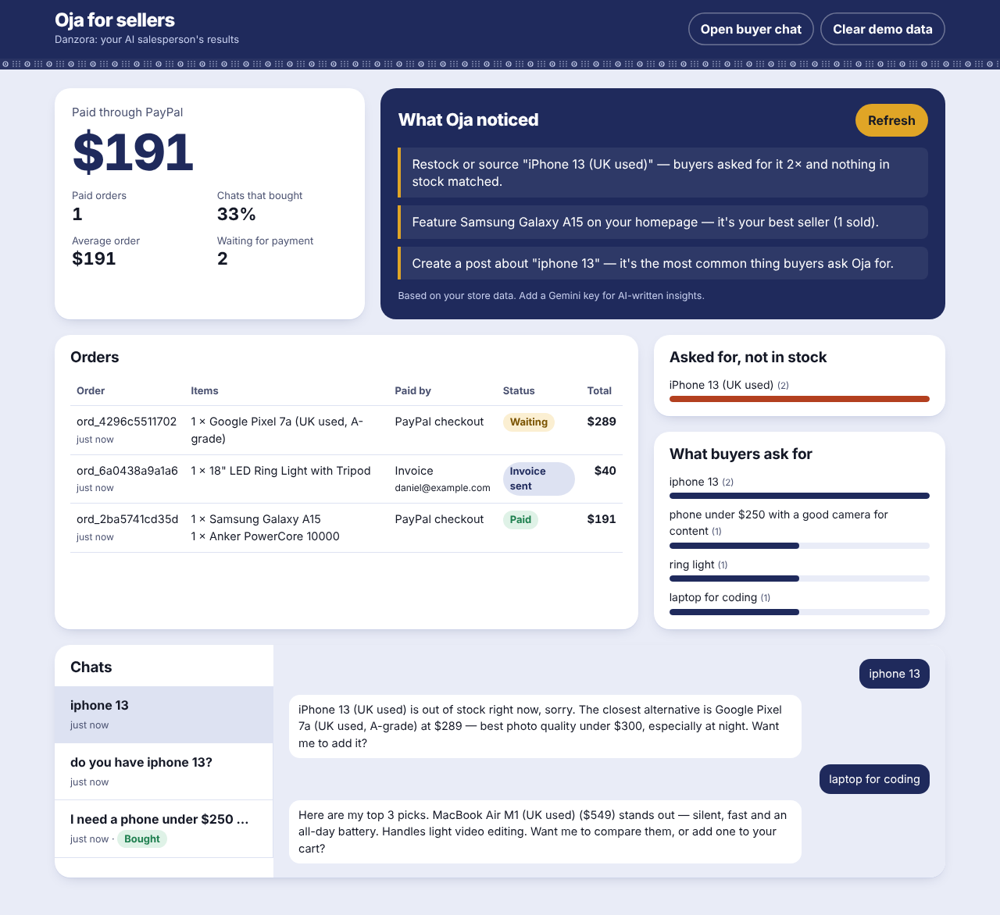

# Oja — from question to paid, in one chat

**Oja** (Yoruba for *market*) is an AI salesperson for small online stores. A buyer describes what they need in plain words. Oja finds the right products, compares them, builds the cart, and takes payment with **PayPal** — without the buyer leaving the conversation. The seller gets a dashboard with every order, every chat, and AI-written insights about what buyers want.

Built for the **PayPal AI Hackathon 2026**. Demo store: **Danzora**, a gadget store in Nigeria.

<p>
  
  
  
</p>



## The problem

Small online sellers in Nigeria and other emerging markets sell mostly through chat. Every sale is a long back-and-forth: "how much?", "is it available?", "which one is better?", "send account details". Buyers drop off at every step, and sellers can't answer at 2 a.m.

## What Oja does

**For buyers**
- Understands needs, not just keywords: *"a phone under $250 with a good camera for content"*.
- Shows product cards, compares options side by side, and is honest when something is out of stock (and offers the closest alternative).
- Builds the cart from conversation: *"add the cheaper one and a power bank"*.
- **Pays inside the chat**: the checkout appears as a receipt with PayPal buttons. Payment is captured and verified on the server, then the receipt is stamped *PAID*.
- **Pay later**: *"send me an invoice"* creates and emails a real PayPal invoice with a QR code, so the buyer can pay from another phone. The chat celebrates when it's paid.
- *"Has my payment gone through?"* checks the order live.

**For sellers** (`/seller`)
- Revenue paid through PayPal, paid orders, conversion rate, average order.
- Every order with its status (paid, waiting, invoice sent).
- **What Oja noticed**: AI-written, actionable insights, e.g. "Restock iPhone 13 — buyers asked for it 5× and nothing matched."
- Unmet demand (asked for, not in stock), top buyer requests, and full chat transcripts.

## How PayPal and AI are used

| | What | Where |
|---|---|---|
| AI | **Google Gemini function calling.** The model decides which tool to call: `search_products`, `compare_products`, `add_to_cart`, `remove_from_cart`, `view_cart`, `create_checkout`, `send_invoice`, `check_order_status`. Up to 6 tool steps per message. | `src/agent/gemini.js`, `src/agent/tools.js` |
| AI | Gemini writes seller insights from store analytics. | `src/insights.js` |
| PayPal | **Orders v2** — the agent's `create_checkout` tool creates an order with itemised breakdown; the PayPal JS SDK buttons render in the chat; the server **captures** and checks the captured amount matches the order before marking it paid. | `src/paypal.js`, `server.js`, `public/app.js` |
| PayPal | **Invoicing v2** — the agent's `send_invoice` tool creates, sends and fetches an invoice, plus PayPal's QR code for paying on another device. The chat polls the invoice until it's paid. | `src/paypal.js` |

**Safety by design:** the AI never sets prices. Every total is computed on the server from the catalog, the agent can only act through tools, and the buyer only ever pays through PayPal — Oja never asks for card or bank details.

## Run it locally (2 minutes)

Requires **Node.js 18+**.

```bash
git clone <this repo>
cd oja
npm install
cp .env.example .env   # optional — works without keys
npm start
```

- Buyer chat: http://localhost:3000
- Seller dashboard: http://localhost:3000/seller

**No keys?** Oja runs in **offline demo mode**: a rule-based assistant drives the same tools, and PayPal is simulated (clearly labelled "test mode"). Every flow can be tried end to end.

**Real AI + real PayPal sandbox:**
1. Get a free Gemini API key at https://aistudio.google.com/apikey and set `GEMINI_API_KEY`.
2. At https://developer.paypal.com → *Apps & Credentials* → *Sandbox*, create an app. Set `PAYPAL_CLIENT_ID` and `PAYPAL_CLIENT_SECRET`, and `PAYPAL_MERCHANT_EMAIL` to your sandbox business account email.
3. Restart. To pay, log in with a **sandbox personal (buyer)** account from *Sandbox → Accounts*.

The bottom of the chat shows which AI and PayPal mode is active.

## Try this conversation

1. *I need a phone under $250 with a good camera for content*
2. *compare them*
3. *add the cheaper one and a power bank*
4. *checkout* → tap the PayPal button
5. *has my payment gone through?*
6. *I want a ring light* → *yes* → *send me an invoice* → enter an email
7. *do you have iphone 13?* (out of stock → alternative)
8. Open `/seller` and press **Refresh** under *What Oja noticed*.

## Project structure

```
server.js               Express API and routes
src/config.js           Environment and modes
src/catalog.js          Store catalog and search
src/store.js            Sessions, carts, orders, events (JSON snapshot in data/)
src/paypal.js           PayPal Orders v2 + Invoicing v2 client (sandbox or mock)
src/agent/tools.js      The agent's tools
src/agent/gemini.js     Gemini function-calling loop
src/agent/offline.js    Offline demo brain (same tools, no key needed)
src/agent/prompt.js     System prompt
src/insights.js         Seller analytics + AI insights
public/                 Buyer chat and seller dashboard (vanilla HTML/CSS/JS)
test/flow.test.js       End-to-end test (offline mode)
```

Run the tests with `npm test`.

## Deploy (free)

On [Render](https://render.com): *New → Web Service* → connect the repo → build command `npm install`, start command `npm start` → add the environment variables from `.env.example`.

## What's next

- WhatsApp channel, so buyers can shop where they already chat.
- Show prices in naira alongside USD.
- Seller-side catalog upload from a spreadsheet or photos.
- PayPal shipment tracking and dispute alerts on the dashboard.

## License

MIT — see [LICENSE](LICENSE).
